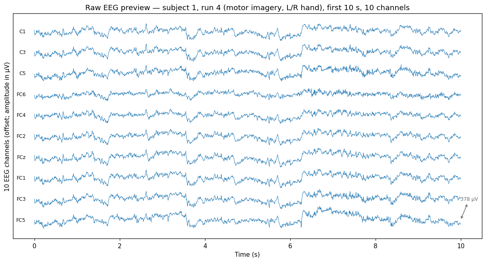
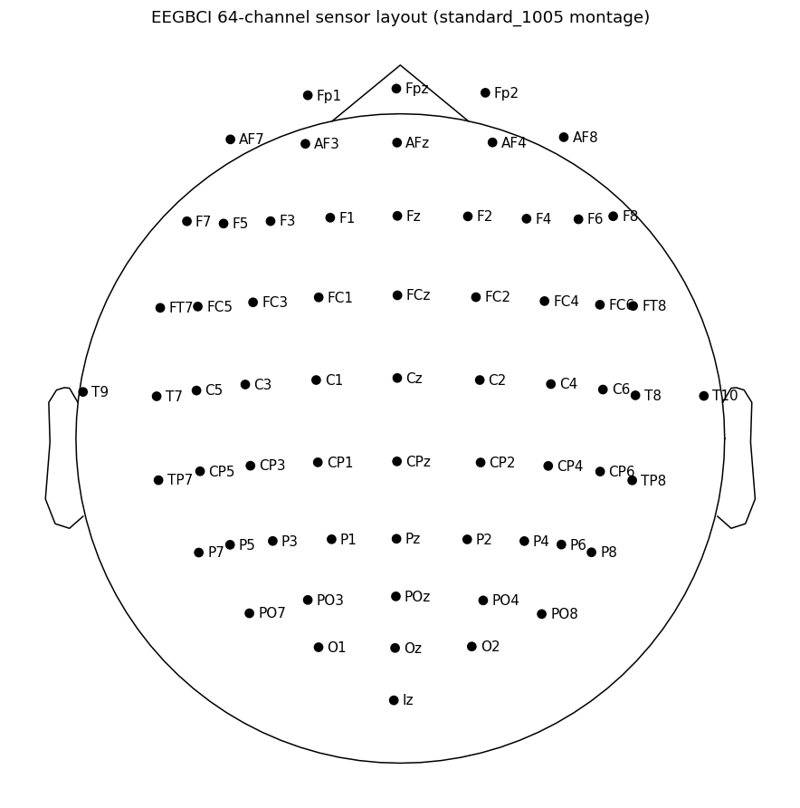
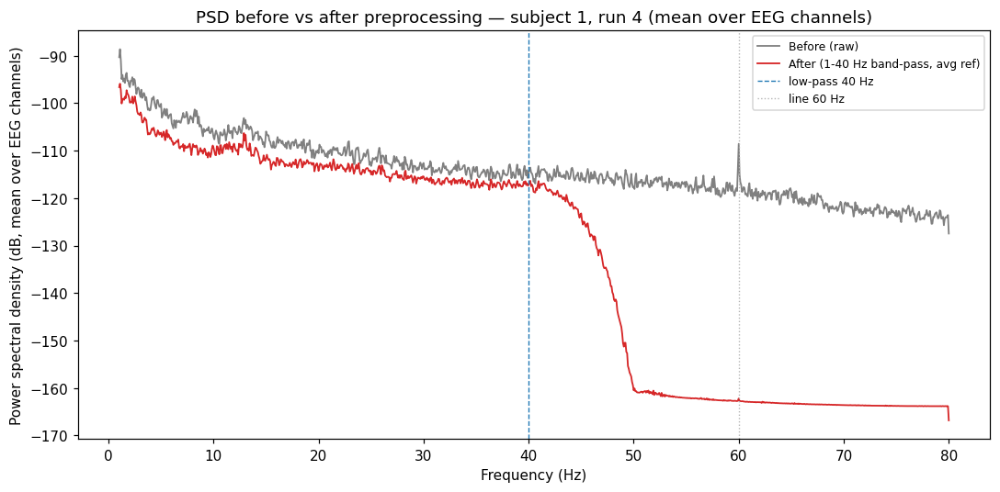
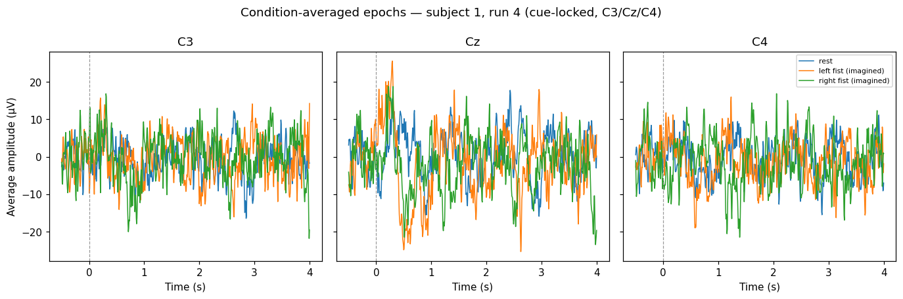
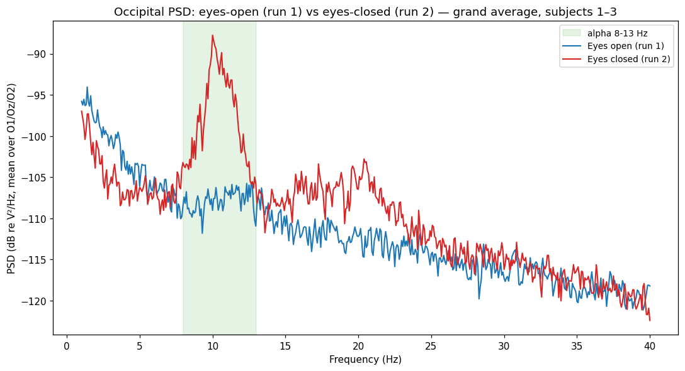
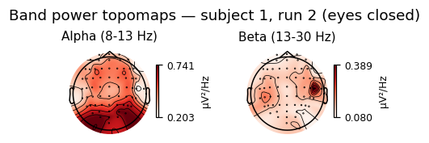

# EEG Signal Processing Lab

> A reproducible EEG signal-processing lab using public motor movement / motor
> imagery data. It focuses on responsible loading, inspection, event mapping,
> preprocessing, epoching, and spectral analysis as a foundation for future
> brain–computer interface (BCI) and neurotechnology work.


-lightgrey)

## Project Status

**Version 1.0 — a complete, reproducible EEG signal-processing lab.** The project
takes a small, well-defined slice of the public PhysioNet motor movement/imagery
data end to end: loading and raw inspection → conservative preprocessing →
run-aware events and cue-locked epochs → spectral (PSD) baseline analysis → a
self-contained HTML report. Two reproducible notebooks drive the analysis and
call into the testable `eeg_lab` package:

- [`notebooks/01_eeg_signal_processing_lab.ipynb`](notebooks/01_eeg_signal_processing_lab.ipynb)
  — **loading & raw inspection** (subjects 1–3, runs 1, 2, 4, 8, 12; confirms
  64 EEG channels @ 160 Hz; maps T0/T1/T2 **by run type**; first figures).
- [`notebooks/02_preprocessing_epochs_psd.ipynb`](notebooks/02_preprocessing_epochs_psd.ipynb)
  — **preprocessing, epochs & PSD** (standard_1005 montage, 1–40 Hz band-pass,
  average reference; cue-locked epochs; eyes-open vs eyes-closed PSD baseline).

The `eeg_lab` package (`config`, `data`, `preprocessing`, `spectral`,
`visualization`, `report`) holds the pure, unit-tested logic. Classification,
deep learning, and real-time control remain **intentionally deferred** — see
[`ROADMAP.md`](ROADMAP.md).

This is an educational, exploratory signal-processing project. **It is not a
clinical or diagnostic tool and makes no medical claims.**

### How to run

```bash
# from an activated environment (see Setup below) — headless, end-to-end
jupyter nbconvert --to notebook --execute --inplace \
  notebooks/01_eeg_signal_processing_lab.ipynb
jupyter nbconvert --to notebook --execute --inplace \
  notebooks/02_preprocessing_epochs_psd.ipynb

# regenerate the self-contained HTML report from the exported figures
python -m eeg_lab.report          # -> reports/eeg_signal_processing_report.html

# run the unit tests (pure logic: event mapping, epoch math, bands, band power)
pytest -q
```

The first notebook execution downloads ~15 small EDF files into the git-ignored
`data/raw/` directory; later runs reuse the local cache. The HTML report embeds
all figures (~2 MB) and is **git-ignored / regenerated locally** — see
[`reports/README.md`](reports/README.md). The source PNGs in
[`figures/`](figures/) are committed.

## Results at a glance

| Figure | What it shows |
| --- | --- |
|  | Raw EEG preview (subject 1, run 4) before any filtering. |
|  | 64-channel `standard_1005` sensor layout. |
|  | Mean PSD before vs after the 1–40 Hz band-pass + average reference. The 60 Hz line peak is removed by the 40 Hz low-pass (so no notch is applied). |
|  | Condition-averaged cue-locked epochs on C3/Cz/C4 (small-sample, descriptive). |
|  | Grand-average occipital PSD: the **expected** eyes-closed alpha (8–13 Hz) increase appears clearly. |
|  | Alpha/beta band-power topography (eyes closed); alpha concentrates posteriorly as expected. |

All observations are descriptive and tied to subjects 1–3 / runs 1, 2, 4, 8, 12.
See [`docs/limitations.md`](docs/limitations.md).

## Why This Project

EEG-based BCI work depends on careful signal handling long before any machine
learning model is useful. EEG is noisy, multidimensional, and easy to misuse.
This repository deliberately starts at the foundation: understanding raw neural
signals, mapping events correctly by run type, documenting preprocessing
decisions transparently, and producing interpretable visual summaries.

The intent is to show maturity with neural data — data loading, event mapping,
filtering, visualization, artifact awareness, reproducibility, and honest
interpretation — rather than to rush a classifier.

## Dataset

Primary dataset: **PhysioNet EEG Motor Movement/Imagery Dataset v1.0.0**.

| Property | Value |
| --- | --- |
| Source | https://physionet.org/content/eegmmidb/1.0.0/ |
| DOI | https://doi.org/10.13026/C28G6P |
| Format | EDF+ (with annotation channel) |
| Channels | 64 EEG channels |
| Sampling rate | 160 Hz |
| Acquisition context | BCI2000 |
| Runs per subject | 14 |
| License | Open Data Commons Attribution License v1.0 (ODC-By) |

The dataset is accessed locally through MNE-Python's
[EEGBCI dataset helper](https://mne.tools/dev/generated/mne.datasets.eegbci.load_data.html).
Full run/event details (including the run-aware meaning of T0/T1/T2) are in
[`docs/dataset_notes.md`](docs/dataset_notes.md).

**Raw dataset files are never committed to this repository.** Downloaded data
is written to a local, git-ignored `data/raw/` directory (see Setup).

### Version 1 analysis slice

- **Subjects:** 1, 2, 3
- **Runs:** 1 (eyes-open baseline), 2 (eyes-closed baseline), 4, 8, 12 (motor
  imagery, left vs right hand)

This is small enough to run quickly while still demonstrating baseline
comparison and motor-imagery inspection. Rationale is documented in
[`docs/project_brief.md`](docs/project_brief.md).

## Repository Structure

```text
eeg-signal-processing-lab/
  README.md                  # This file
  LICENSE                    # MIT license for repository CODE
  CITATION.md                # How to cite the dataset, MNE-Python, and this repo
  ROADMAP.md                 # Versioning plan and deferred work
  pyproject.toml             # Project metadata + planned dependencies
  requirements.txt           # Convenience mirror of runtime dependencies
  .gitignore                 # Ignores raw data, EDF files, caches, envs
  docs/
    00_*..05_*.md            # Original planning files (source of truth)
    project_brief.md         # Public-facing condensed brief
    dataset_notes.md         # Dataset facts, run table, event mapping
    preprocessing_decisions.md  # Conservative preprocessing decision log
    limitations.md           # Honest limitations
  src/eeg_lab/               # Python package (pure, testable logic)
    __init__.py
    config.py                # Subjects/runs/paths, event mapping, filter/epoch/band constants
    data.py                  # MNE EEGBCI loading helpers
    preprocessing.py         # Conservative preprocessing + run-aware events/epochs
    spectral.py              # PSD + band-power helpers
    visualization.py         # Figure helpers
    report.py                # Reproducible HTML report assembly
  tests/                     # Unit tests (pure logic only; no network/data needed)
    test_dataset_config.py
    test_event_mapping.py
    test_epochs.py           # epoch window, event_id, count tables
    test_spectral.py         # band definitions, band-power integration
  notebooks/
    01_eeg_signal_processing_lab.ipynb     # loading & raw inspection
    02_preprocessing_epochs_psd.ipynb      # preprocessing, epochs & PSD
  reports/                   # HTML report regenerated locally (README + .gitkeep tracked)
  figures/                   # Exported PNG figures (committed)
  data/raw/                  # Local downloaded EEG data (GIT-IGNORED)
```

## Setup / Installation

Requires **Python 3.11+**. Dependencies are declared in
[`pyproject.toml`](pyproject.toml) (with a convenience mirror in
[`requirements.txt`](requirements.txt)). The core stack is MNE-Python, NumPy,
pandas, Matplotlib, SciPy, and Jupyter.

```bash
# 1. Clone
git clone https://github.com/jevrton-code/eeg-signal-processing-lab.git
cd eeg-signal-processing-lab

# 2. Create and activate a virtual environment
python3 -m venv .venv
source .venv/bin/activate          # Windows: .venv\Scripts\activate

# 3. Install dependencies (choose one)
pip install -e ".[dev]"            # from pyproject (editable, with dev tools)
# or
pip install -r requirements.txt    # runtime deps only
```

### Where data lives

EEG recordings are **not** part of this repository. MNE-Python's EEGBCI helper
downloads selected subject/run files into a local, git-ignored directory on
first run:

```text
data/raw/    # downloaded EDF files (gitignored — never committed)
```

`data/` and common EEG formats (`*.edf`, `*.fif`, ...) are excluded via
[`.gitignore`](.gitignore), so raw signals cannot be accidentally committed.

## Pipeline

1. Select subjects and runs (subjects 1–3; runs 1, 2, 4, 8, 12).
2. Load EEG recordings via MNE EEGBCI (`eeg_lab.data`).
3. Inspect raw signals — channels, sampling rate, duration, montage (notebook 01).
4. Apply conservative preprocessing — `standard_1005` montage, **1–40 Hz**
   band-pass, **average** reference; notch inspected and deferred (covered by the
   40 Hz low-pass); ICA deferred (`eeg_lab.preprocessing`).
5. Parse events and map labels **by run type** (T0 = rest; T1/T2 = left/right
   imagined fist only in runs 4, 8, 12); build per-condition count tables.
6. Create cue-locked epochs with a stated window (**−0.5 to +4.0 s**, baseline
   `(None, 0)`).
7. Generate PSD summaries — eyes-open vs eyes-closed baseline (`eeg_lab.spectral`)
   and optional alpha/beta topomaps.
8. Assemble a reproducible HTML report and curated figures (`eeg_lab.report`).
9. Document every decision and the limitations.

Each stage and its acceptance criteria are tracked in
[`ROADMAP.md`](ROADMAP.md); preprocessing parameters and rationale are in
[`docs/preprocessing_decisions.md`](docs/preprocessing_decisions.md).

## What This Project Shows

- EEG signal-processing fundamentals.
- Practical use of MNE-Python.
- Scientific documentation and reproducibility habits.
- Careful, cautious interpretation of noisy biosignals.
- A bridge between software engineering and neurotechnology.

## Limitations

The first versions use a small subject subset; preprocessing choices are
educational and exploratory; results should not be generalized; no medical or
diagnostic interpretation is provided; and classification is reserved for
future work. Full details in [`docs/limitations.md`](docs/limitations.md).

## License and Citation

- **Repository code** is released under the [MIT License](LICENSE).
- **The dataset** is licensed separately under the Open Data Commons
  Attribution License v1.0 (ODC-By) by PhysioNet — see
  [`CITATION.md`](CITATION.md) for full attribution of the dataset,
  MNE-Python, and this repository.

These two licenses are independent. Using this code does not grant any rights
over the dataset, and vice versa.

## References

- PhysioNet EEG Motor Movement/Imagery Dataset: https://physionet.org/content/eegmmidb/1.0.0/
- MNE-Python: https://mne.tools/
- MNE EEGBCI dataset helper: https://mne.tools/dev/generated/mne.datasets.eegbci.load_data.html

## GitHub Topics

`eeg` · `bci` · `brain-computer-interface` · `neurotechnology` ·
`signal-processing` · `mne-python` · `python` · `neuroscience` ·
`motor-imagery` · `open-science`
